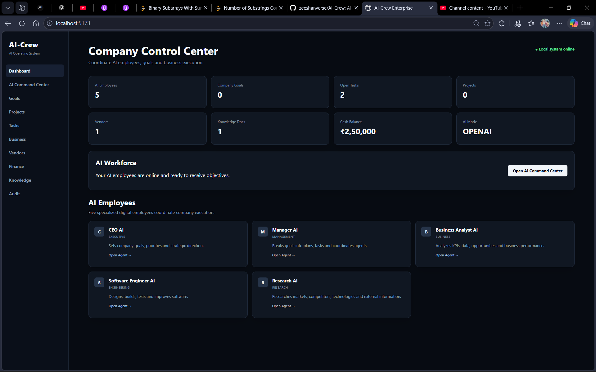
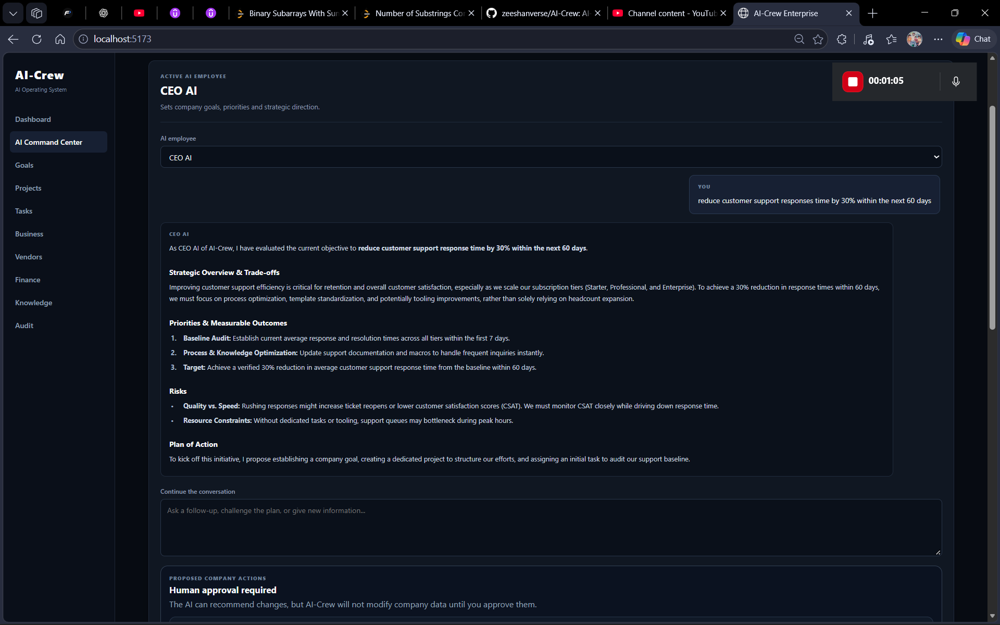
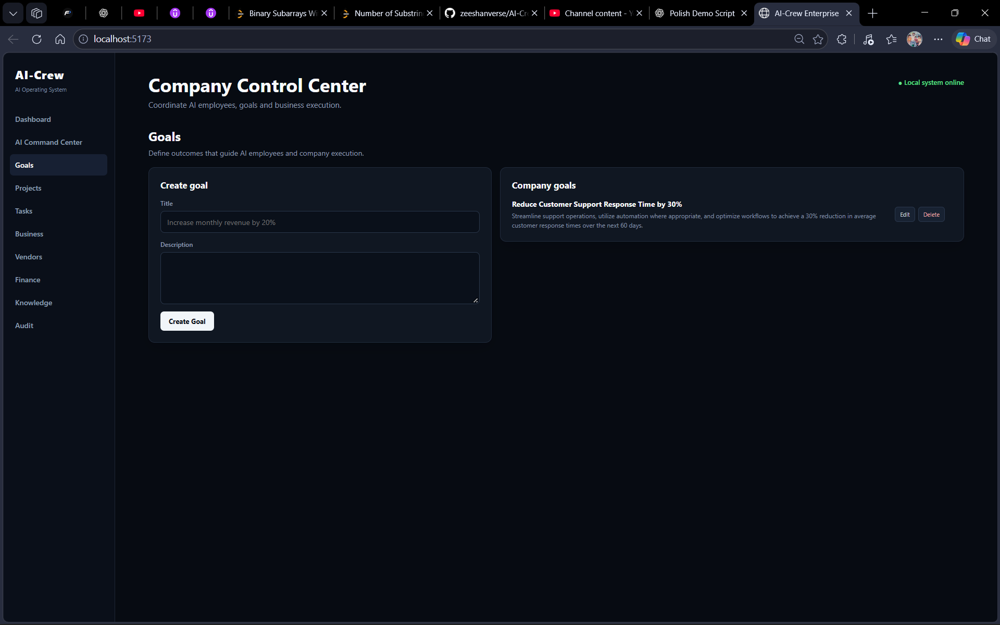
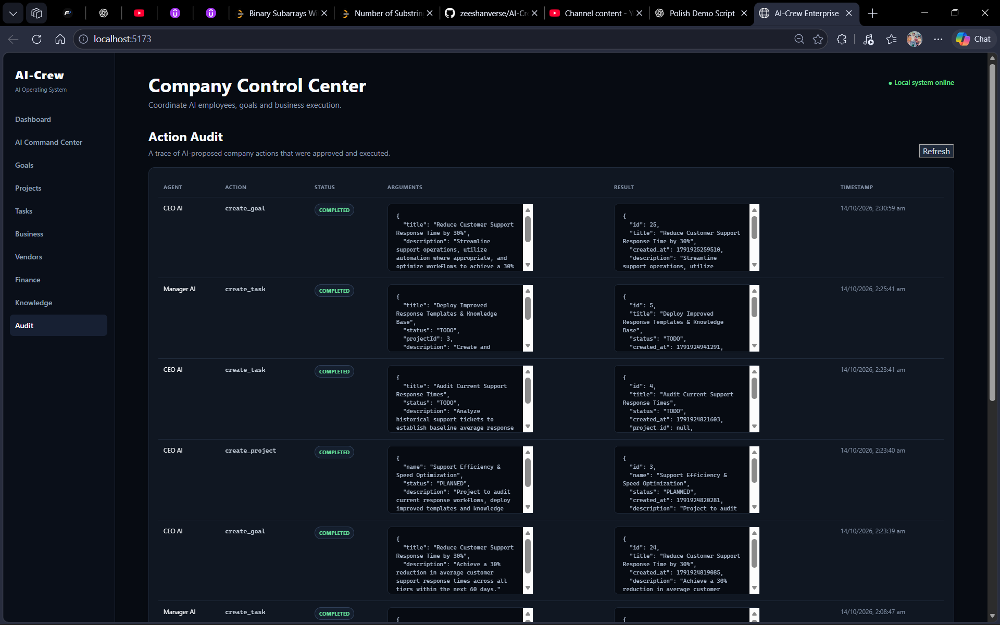
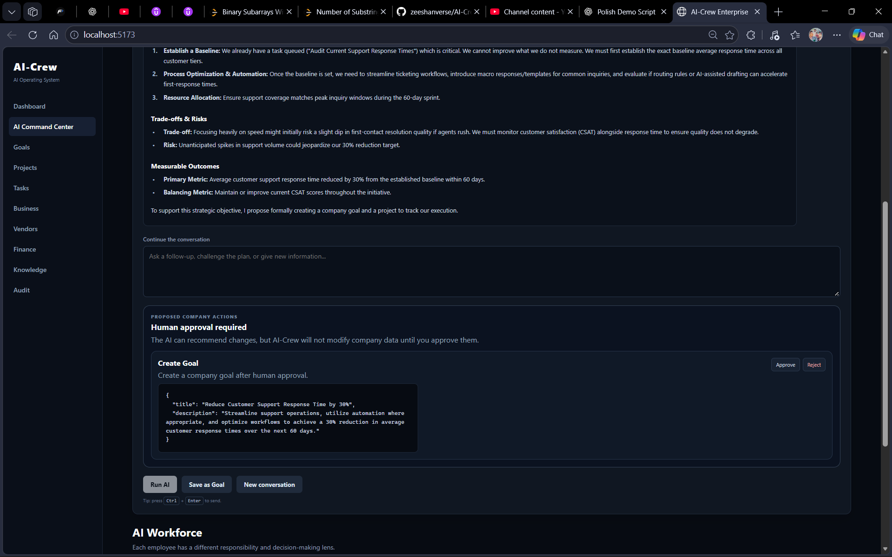
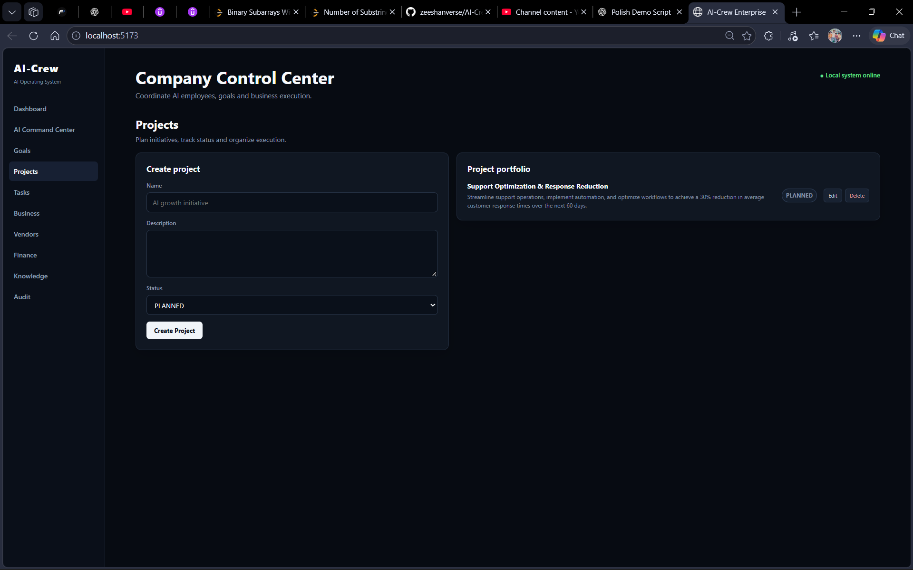
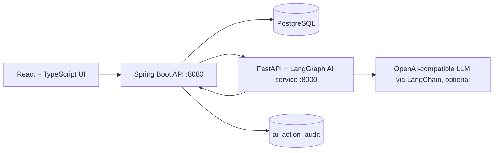

# AI-Crew — Human-in-the-Loop AI Company Operating System


AI-Crew is a multi-service platform where five role-based AI employees (CEO, Manager, Business Analyst, Software Engineer, Research) help run a small company. You give an employee an objective; it reads company data, recommends a plan, and **proposes** concrete actions such as creating a goal, project or task. Nothing is written until **you approve it**, and every executed action is saved to an audit table.


## Demo


🎥 **[Watch the AI-Crew Demo](https://youtu.be/vuon2fvFuXo)**


> AI proposes → human approves → Spring Boot executes → PostgreSQL persists → audit trail records the action.


### Demo Screenshots


| Dashboard | CEO AI — Command Center |

|---|---|

|  |  |


| Human Approval | Goals |

|---|---|

|  |  |


| Audit Trail | Manager AI — Command Center |

|---|---|

|  |  |


| Projects |

|---|

|  |


## How the loop works


1. You give an AI employee an objective in the **AI Command Center**.

2. The AI service retrieves the company snapshot and matching knowledge documents, then the agent (run through a LangGraph graph) reasons over them.

3. It replies with a recommendation and, when useful, **proposes write actions**. Proposals come back as a structured JSON block and are validated (allowed action names, required fields, known project ids) before they reach the UI.

4. You approve or reject each action in the UI.

5. Approved actions are executed through the Spring Boot API and stored in PostgreSQL.

6. Every executed action is recorded in the `ai_action_audit` table (agent, tool, arguments, result, status, timestamp).

7. You continue the conversation, and the agent sees the updated company state.


Agents never write to the database directly. They can only propose, and the backend performs the action after approval. Supported actions: `create_goal`, `create_project`, `create_task`, `create_metric`, `create_vendor`, `record_transaction`, `create_knowledge_document`.


## Architecture





The AI service calls the backend's internal endpoints (protected by a shared internal token) to read company context. The agent uses an OpenAI-compatible LLM interface, allowing providers such as OpenAI, Gemini, Groq, OpenRouter, or compatible local models. Approved actions are executed by the backend.


| Service | Role | Port |

|---|---|---|

| `frontend/` | React + TypeScript (Vite) UI | 5173 |

| `backend/` | Spring Boot REST API, Flyway migrations, executes approved actions | 8080 |

| `ai/` | FastAPI service running the LangGraph agent workflow | 8000 |

| PostgreSQL | Data store (pgvector-enabled image, reserved for planned semantic search) | 5432 |

| Redis | Provisioned in Compose for planned background jobs; **not used yet** | 6379 |


## Features


- **Five AI employees** with distinct role guidance.

- **Context-aware agents:** company data and knowledge are retrieved before every answer; write actions are validated **proposals** only.

- **Approval workflow and audit trail** for every AI-initiated change.

- **Company modules:** dashboard, goals, projects, tasks, business KPIs, vendors, finance ledger and knowledge documents, each with CRUD endpoints, plus an **Audit** page listing every executed AI action (`GET /api/ai/audit`).

- **Two AI modes:** `mock` (default; requires no API key and returns role-specific canned responses) and `openai` (live reasoning through LangChain using an OpenAI-compatible LLM provider).

- **One-command setup** with Docker Compose.


## Tech stack


Java 21, Spring Boot, Flyway · Python 3.11, FastAPI, LangGraph, LangChain · React, TypeScript, Vite · PostgreSQL · Docker Compose · JUnit 5, pytest


---


## Run locally


### Option 1: Docker (recommended)


Requirements: Docker Desktop (or Docker Engine) with Docker Compose v2. Nothing else is needed.


```bash

git clone https://github.com/zeeshanverse/AI-Crew.git

cd AI-Crew


cp .env.example .env            # Windows PowerShell: Copy-Item .env.example .env

docker compose up --build -d

docker compose ps               # wait until all services are running and postgres is healthy

```


Open **http://localhost:5173**.


| What | URL |

|---|---|

| Frontend | http://localhost:5173 |

| Backend API | http://localhost:8080/api/agents |

| AI service health | http://localhost:8000/health |

| AI mode as seen by the backend | http://localhost:8080/api/ai/status |


Quick check:


```bash

curl http://localhost:8000/health

curl http://localhost:8080/api/ai/status

# expect "mode":"mock" and "live_enabled":false until you add an LLM key

```


Windows PowerShell: plain `curl` is an alias for `Invoke-WebRequest` and shows a security prompt. Use `curl.exe` or `Invoke-RestMethod` instead:


```powershell

curl.exe http://localhost:8080/api/ai/status

Invoke-RestMethod http://localhost:8080/api/ai/status

```


Useful commands:


```bash

docker compose logs -f ai          # follow the AI service logs

docker compose down                # stop everything, keep data

docker compose down -v             # stop and delete the database volume (fresh start)

```


### Enable live AI reasoning (optional)


The default `AI_MODE=mock` requires no credentials. For live LLM reasoning, set `AI_MODE=openai` in `.env` and configure **one** OpenAI-compatible provider.


**Option A: OpenAI** (needs an account with credit)


```text

AI_MODE=openai

OPENAI_API_KEY=your_key_here

OPENAI_MODEL=gpt-5-mini

```


**Option B: any OpenAI-compatible provider, including free tiers** (Gemini, Groq, OpenRouter, a local Ollama server)


```text

AI_MODE=openai

LLM_BASE_URL=https://generativelanguage.googleapis.com/v1beta/openai/

LLM_API_KEY=your_gemini_key

LLM_MODEL=a_gemini_model_that_supports_tool_calling

```


`LLM_*` values override the `OPENAI_*` ones when both are set. Then recreate the containers and verify:


```bash

docker compose up -d

curl http://localhost:8080/api/ai/status     # Windows PowerShell: curl.exe ...

# expect "mode":"openai" and "live_enabled":true

```


If the key is empty, the service stays in mock mode, so check `live_enabled`. If the provider fails at request time (no credits, bad key, rate limit), the agent still answers with the offline mock response and shows a "Live AI unavailable" notice explaining why. Never commit `.env`.


### Option 2: Run each service without Docker (for development)


Requirements: JDK 21, Maven 3.9+, Python 3.11, Node.js 20, and Docker (only for PostgreSQL).


**1. Start PostgreSQL**


```bash

docker compose up -d postgres

```


**2. Backend** (terminal 1). The defaults connect to `localhost:5432/ai_crew` and the AI service on `localhost:8000`; Flyway creates the schema on startup.


```bash

cd backend

mvn spring-boot:run

```


**3. AI service** (terminal 2). The backend URL must point to localhost instead of the Docker hostname.


```bash

cd ai

python -m venv .venv

source .venv/bin/activate                 # Windows: .venv\Scripts\activate

pip install -r requirements.txt


export INTERNAL_API_BASE_URL=http://localhost:8080      # PowerShell: $env:INTERNAL_API_BASE_URL="http://localhost:8080"

# optional real mode:

# export AI_MODE=openai OPENAI_API_KEY=your_key_here


uvicorn app.main:app --reload --port 8000

```


**4. Frontend** (terminal 3)


```bash

cd frontend

npm install

npm run dev

```


Open http://localhost:5173.


### Try the API from the command line


```bash

curl http://localhost:8080/api/agents

curl http://localhost:8080/api/dashboard


curl -X POST http://localhost:8080/api/ai/run \

  -H "Content-Type: application/json" \

  -d '{"agent":"CEO","objective":"Increase monthly revenue by 20%","context":{}}'

```


Windows PowerShell (use `curl.exe` or `Invoke-RestMethod`; plain `curl` is an alias with different behavior):


```powershell

$body = @{ agent = "CEO"; objective = "Reduce customer support response time by 30% within the next 60 days"; context = @{} } | ConvertTo-Json -Compress

Invoke-RestMethod -Uri "http://localhost:8080/api/ai/run" -Method POST -ContentType "application/json" -Body $body

```


### Troubleshooting


| Problem | Fix |

|---|---|

| `/api/ai/status` returns 502 / "unavailable" | The AI service is not running or not reachable. Check `docker compose logs ai` (Docker) or `INTERNAL_API_BASE_URL` (non-Docker). |

| Port already in use | Change `POSTGRES_PORT`, `BACKEND_PORT`, `AI_PORT`, `REDIS_PORT` or `FRONTEND_PORT` in `.env` and restart. |

| Backend fails on Flyway or schema validation | Reset the database with `docker compose down -v`, then start again. |

| Agents always give canned answers | You are in mock mode, or the provider is failing. Set `AI_MODE=openai` with a valid key, confirm `live_enabled` is `true`, and read any "Live AI unavailable" notice in the reply (for example no credits or a wrong model name). `docker compose logs ai` shows the full error. |

| Dashboard shows "Failed to fetch" | The backend is not running. Check `docker compose ps` and `docker compose logs backend --tail=50`. |

| UI shows network or CORS errors | The backend only allows the UI origin `http://localhost:5173`. Open the UI on that exact address. |


---


## Try the demo flow


1. Open **AI Command Center**, pick **CEO AI**, and enter "Reduce customer support response time by 30% within the next 60 days".

2. Approve the proposed goal.

3. Open **Goals** to verify that the approved goal was persisted.

4. Open **Audit** to verify that the approved AI action was recorded.

5. Start a **New Conversation**, select **Manager AI**, and ask it to turn the goal "Reduce customer support response time by 30% within the next 60 days" into a project with initial tasks.

6. Review and approve the proposed project and tasks, then open **Projects** to verify the result.

7. Open **Audit** again to see the approved actions that were executed.


In mock mode, responses are canned but the propose, approve and audit flow works the same way.


## Tests


```bash

cd ai && pip install -r requirements.txt && pytest      # health, agent endpoints, provider-failure fallback

cd backend && mvn test                                   # agent catalog test

```


More documentation: [`docs/ARCHITECTURE.md`](docs/ARCHITECTURE.md) · [`docs/RUN_AND_TEST.md`](docs/RUN_AND_TEST.md) · [`docs/ROADMAP.md`](docs/ROADMAP.md) · [`PROJECT_STATUS.md`](PROJECT_STATUS.md)


## Current limitations


- Proposals use a structured JSON block instead of native model tool calling, which keeps behavior consistent across OpenAI-compatible providers.

- `mock` is the default mode, so agent output is canned until you enable a real provider. Live mode has not been tested against every provider; OpenAI-compatible endpoints with tool-calling support are expected to work.

- No authentication or multi-user support yet, so run it locally or behind your own gateway rather than exposing it publicly.

- Knowledge search is keyword matching. `rag.py`, `mcp.py` and `tools.py` are placeholders for planned semantic search and integrations.

- Redis is provisioned but not used yet.

- Test coverage is minimal.


## Roadmap


Authentication and RBAC · RAG over knowledge documents with pgvector · persistent conversation history · background jobs on Redis · external integrations via MCP · analytics dashboards


## Author


**Mohammed Zeeshan** — [GitHub](https://github.com/zeeshanverse) · [LinkedIn](https://www.linkedin.com/in/zeeshanmohd/)
